# System Architecture Flowchart

This Mermaid diagram shows the complete system architecture with clickable links to source files.

Render this on GitHub by viewing this file, or paste into [mermaid.live](https://mermaid.live) for interactive viewing.

```mermaid
flowchart TD

subgraph group_client["Web Client"]
  node_frontend["React App<br/>[App.tsx]"]
  node_authui["Auth Screens<br/>[LoginPage.tsx]"]
  node_habitui["Habit Check-ins<br/>[CheckInPage.tsx]"]
  node_analyticsui["Analytics Views<br/>[AnalyticsPage.tsx]"]
  node_chatui["AI Chat UI<br/>[ChatPage.tsx]"]
  node_webapi["API Services<br/>[api.ts]"]
end

subgraph group_core["Health Tracking"]
  node_auth["Authentication"]
  node_habits["Habit Management"]
  node_logs["Daily Logs"]
  node_analytics["Analytics"]
end

subgraph group_insights["AI Insights"]
  node_ai["AI Service<br/>[service.py]"]
  node_agent["ReAct Coach<br/>[health_coach.py]"]
  node_rag["Document RAG"]
  node_workflow["Weekly Report Flow"]
  node_llm["LLM Providers"]
end

subgraph group_delivery["User Delivery"]
  node_notifications["Notifications"]
  node_export["Data Export"]
  node_storage["S3-Compatible Storage<br/>[storage.py]"]
  node_lambda["Scheduled / Async Tasks"]
end

subgraph group_runtime["Backend Runtime"]
  node_database[("PostgreSQL<br/>[database.py]")]
  node_redis[("Redis Services<br/>[redis_client.py]")]
  node_api["FastAPI Application<br/>[main.py]"]
end

node_user(("Health Tracker User"))
node_email["Email Service"]

node_user -->|"uses"| node_frontend
node_frontend -->|"routes to"| node_authui
node_frontend -->|"routes to"| node_habitui
node_frontend -->|"routes to"| node_analyticsui
node_frontend -->|"routes to"| node_chatui

node_authui -->|"requests"| node_webapi
node_habitui -->|"requests"| node_webapi
node_analyticsui -->|"requests"| node_webapi
node_chatui -->|"requests"| node_webapi

node_webapi -->|"calls"| node_api

node_api -->|"dispatches"| node_auth
node_api -->|"dispatches"| node_habits
node_api -->|"dispatches"| node_logs
node_api -->|"dispatches"| node_analytics
node_api -->|"dispatches"| node_ai
node_api -->|"dispatches"| node_notifications
node_api -->|"dispatches"| node_export

node_auth -->|"reads/writes"| node_database
node_habits -->|"reads/writes"| node_database
node_logs -->|"reads/writes"| node_database
node_analytics -->|"queries"| node_database
node_analytics -->|"caches"| node_redis

node_ai -->|"requests completions"| node_llm
node_ai -->|"invokes"| node_agent
node_ai -->|"processes documents"| node_rag
node_ai -->|"runs report"| node_workflow
node_ai -->|"reads/writes"| node_database
node_ai -->|"tracks usage"| node_redis

node_agent -->|"queries logs"| node_logs
node_workflow -->|"analyzes and writes"| node_llm
node_workflow -->|"collects data"| node_database
node_rag -->|"stores vectors"| node_database

node_export -->|"uploads files"| node_storage
node_export -->|"reads data"| node_database
node_notifications -->|"sends messages"| node_email

node_lambda -->|"reads/writes"| node_database
node_lambda -->|"sends messages"| node_email
node_lambda -->|"uploads exports"| node_storage
node_lambda -.->|"generates reports"| node_llm

click node_frontend "https://github.com/tejaswikg08dev/health-tracker/blob/main/frontend/src/App.tsx"
click node_authui "https://github.com/tejaswikg08dev/health-tracker/blob/main/frontend/src/pages/LoginPage.tsx"
click node_habitui "https://github.com/tejaswikg08dev/health-tracker/blob/main/frontend/src/pages/CheckInPage.tsx"
click node_analyticsui "https://github.com/tejaswikg08dev/health-tracker/blob/main/frontend/src/pages/AnalyticsPage.tsx"
click node_chatui "https://github.com/tejaswikg08dev/health-tracker/blob/main/frontend/src/pages/ChatPage.tsx"
click node_webapi "https://github.com/tejaswikg08dev/health-tracker/blob/main/frontend/src/services/api.ts"
click node_auth "https://github.com/tejaswikg08dev/health-tracker/tree/main/backend/app/modules/auth"
click node_habits "https://github.com/tejaswikg08dev/health-tracker/tree/main/backend/app/modules/habits"
click node_analytics "https://github.com/tejaswikg08dev/health-tracker/tree/main/backend/app/modules/analytics"
click node_database "https://github.com/tejaswikg08dev/health-tracker/blob/main/backend/app/database.py"
click node_redis "https://github.com/tejaswikg08dev/health-tracker/blob/main/backend/app/redis_client.py"
click node_api "https://github.com/tejaswikg08dev/health-tracker/blob/main/backend/app/main.py"
click node_ai "https://github.com/tejaswikg08dev/health-tracker/blob/main/backend/app/modules/ai/service.py"
click node_agent "https://github.com/tejaswikg08dev/health-tracker/blob/main/backend/app/modules/ai/agents/health_coach.py"
click node_rag "https://github.com/tejaswikg08dev/health-tracker/tree/main/backend/app/modules/ai/rag"
click node_workflow "https://github.com/tejaswikg08dev/health-tracker/tree/main/backend/app/modules/ai/workflows/weekly_report"
click node_llm "https://github.com/tejaswikg08dev/health-tracker/tree/main/backend/app/modules/ai/llm"
click node_notifications "https://github.com/tejaswikg08dev/health-tracker/tree/main/backend/app/modules/notifications"
click node_export "https://github.com/tejaswikg08dev/health-tracker/tree/main/backend/app/modules/export"
click node_storage "https://github.com/tejaswikg08dev/health-tracker/blob/main/backend/app/modules/export/storage.py"
click node_lambda "https://github.com/tejaswikg08dev/health-tracker/tree/main/lambda_functions"

classDef toneBlue fill:#dbeafe,stroke:#2563eb,stroke-width:1.5px,color:#172554
classDef toneAmber fill:#fef3c7,stroke:#d97706,stroke-width:1.5px,color:#78350f
classDef toneMint fill:#dcfce7,stroke:#16a34a,stroke-width:1.5px,color:#14532d
classDef toneRose fill:#ffe4e6,stroke:#e11d48,stroke-width:1.5px,color:#881337
classDef toneIndigo fill:#e0e7ff,stroke:#4f46e5,stroke-width:1.5px,color:#312e81

class node_frontend,node_authui,node_habitui,node_analyticsui,node_chatui,node_webapi,node_user toneBlue
class node_auth,node_habits,node_logs,node_analytics toneAmber
class node_ai,node_agent,node_rag,node_workflow,node_llm toneMint
class node_notifications,node_export,node_storage,node_lambda toneRose
class node_database,node_redis,node_api,node_email toneIndigo
```



## How to Read This Diagram

| Color | Group | What It Contains |
|-------|-------|-----------------|
| 🔵 Blue | Web Client | React pages, API service layer, user interactions |
| 🟡 Amber | Health Tracking | Core business: auth, habits, logs, analytics |
| 🟢 Green | AI Insights | LLM providers, RAG pipeline, ReAct agent, workflows |
| 🔴 Rose | User Delivery | Notifications, export, S3 storage, Lambda functions |
| 🟣 Indigo | Backend Runtime | FastAPI, PostgreSQL, Redis |

## Key Data Flows

**User logs a habit:**
```
User → React CheckInPage → api.ts → FastAPI → Logs module → PostgreSQL
                                                    ↓
                                              Redis (invalidate analytics cache)
                                                    ↓
                                              SQS → Lambda (streak milestone check)
```

**User asks AI a question:**
```
User → React ChatPage → api.ts → FastAPI → AI Service → HealthCoachAgent
                                                ↓
                                    ReAct Loop: LLM thinks → calls tools → observes
                                    Tools query: Logs module, Analytics, RAG (pgvector)
                                                ↓
                                    Final answer with real data → User
```

**Weekly report generation:**
```
EventBridge cron → Lambda weekly_report
    → DataCollector (queries PostgreSQL)
    → Analyzer (calls Groq LLM)
    → ReportWriter (calls Groq LLM)
    → Upload HTML to S3
    → Send email via SES
```
